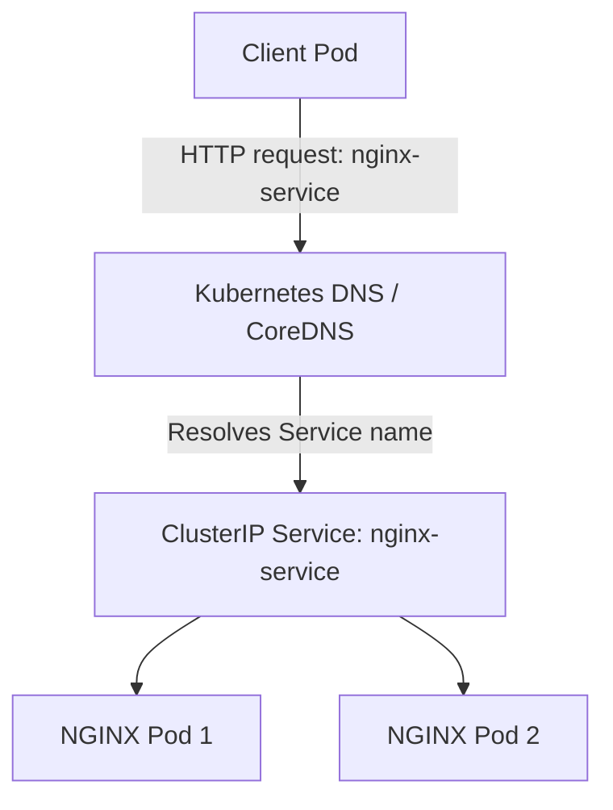

# Lab 11: Kubernetes DNS & Service Discovery

## Objectives

- Deploy two NGINX Pods in an isolated namespace.
- Expose the Pods through a ClusterIP Service.
- Access the Service using its short DNS name.
- Access the Service using its fully qualified domain name (FQDN).
- Verify DNS resolution with `nslookup`.

## Architecture



## Prerequisites

- A working Kubernetes cluster.
- `kubectl` configured to use the intended cluster.
- The examples below use Minikube and a dedicated namespace named `lab-11`.

## 1. Create the namespace

```bash
kubectl create namespace lab-11
kubectl get namespace lab-11
```

If the namespace already exists, reuse it instead of deleting it.

## 2. Create the Deployment

Save as `deployment.yaml`:

```yaml
apiVersion: apps/v1
kind: Deployment
metadata:
  name: nginx-app
  namespace: lab-11
spec:
  replicas: 2
  selector:
    matchLabels:
      app: nginx
  template:
    metadata:
      labels:
        app: nginx
    spec:
      containers:
        - name: nginx
          image: nginx:stable
          ports:
            - containerPort: 80
```

Apply and verify:

```bash
kubectl apply -f deployment.yaml
kubectl get deployments,pods -n lab-11
```

Expected: the Deployment reports `2/2` ready and both Pods are `Running`.

## 3. Create the ClusterIP Service

Save as `service.yaml`:

```yaml
apiVersion: v1
kind: Service
metadata:
  name: nginx-service
  namespace: lab-11
spec:
  type: ClusterIP
  selector:
    app: nginx
  ports:
    - protocol: TCP
      port: 80
      targetPort: 80
```

Apply and inspect the Service and its endpoints:

```bash
kubectl apply -f service.yaml
kubectl get service nginx-service -n lab-11
kubectl get endpoints nginx-service -n lab-11
```

The Service selector `app: nginx` must match the Pods' labels. The Service should have a ClusterIP and endpoints for the two NGINX Pods.

> Note: Kubernetes v1.33 and newer deprecate the legacy Endpoints API in favor of EndpointSlice. To inspect the modern resource, run `kubectl get endpointslice -n lab-11`.

## 4. Test the short Service DNS name

Run a temporary BusyBox Pod and request the NGINX page:

```bash
kubectl run dns-test \
  -n lab-11 \
  --image=busybox:1.36 \
  --restart=Never \
  --rm -i \
  --command -- \
  wget -qO- http://nginx-service
```

Expected: HTML containing `Welcome to nginx!`.

Because the client Pod is in the same namespace as the Service, the short name `nginx-service` can be resolved using Kubernetes DNS search domains.

## 5. Test the fully qualified domain name (FQDN)

```bash
kubectl run dns-test \
  -n lab-11 \
  --image=busybox:1.36 \
  --restart=Never \
  --rm -i \
  --command -- \
  wget -qO- http://nginx-service.lab-11.svc.cluster.local
```

Expected: the same NGINX welcome page.

The FQDN is composed of:

- Service name: `nginx-service`
- Namespace: `lab-11`
- Service DNS domain: `svc.cluster.local`

The cluster DNS domain can differ from `cluster.local` in other Kubernetes environments.

## 6. Verify DNS resolution

```bash
kubectl run dns-lookup \
  -n lab-11 \
  --image=busybox:1.36 \
  --restart=Never \
  --rm -i \
  --command -- \
  nslookup nginx-service.lab-11.svc.cluster.local
```

Example of the successful result:

```text
Server:    10.96.0.10
Address:   10.96.0.10:53

Name:      nginx-service.lab-11.svc.cluster.local
Address:   10.105.81.35
```

The DNS server address and Service ClusterIP may differ between clusters. In this lab, the lookup returned the Service ClusterIP `10.105.81.35`.

## Key concepts

| Concept | Purpose |
|---|---|
| Deployment | Maintains the desired number of Pods |
| Pod labels | Identify which Pods belong to the Service |
| ClusterIP Service | Provides a stable in-cluster virtual IP and load-balances traffic to matching Pods |
| CoreDNS | Resolves Kubernetes Service DNS names |
| Short DNS name | Convenient for communication within the same namespace |
| FQDN | Identifies a Service by name and namespace |

## Troubleshooting

- **Service has no endpoints:** check that `spec.selector` matches the Pod labels using `kubectl get pods -n lab-11 --show-labels`.
- **DNS lookup fails:** check CoreDNS Pods with `kubectl get pods -n kube-system` and inspect the Service with `kubectl get svc -n lab-11`.
- **Temporary Pod attach warning:** commands using `--rm` may finish before `kubectl` attaches to the container. If the expected HTML or DNS result is printed, the test itself may still have succeeded. For clearer output, create a non-ephemeral test Pod and inspect its logs.

## Cleanup

Remove only the resources created for this lab:

```bash
kubectl delete namespace lab-11
```

This deletes the namespace and its resources. Do not run this if you want to keep the lab running.

## Results

- [x] Created a Deployment with two NGINX Pods.
- [x] Exposed the Pods through a ClusterIP Service.
- [x] Retrieved the NGINX welcome page using the short Service name.
- [x] Retrieved the page using the Service FQDN.
- [x] Resolved the FQDN to the Service ClusterIP with `nslookup`.
